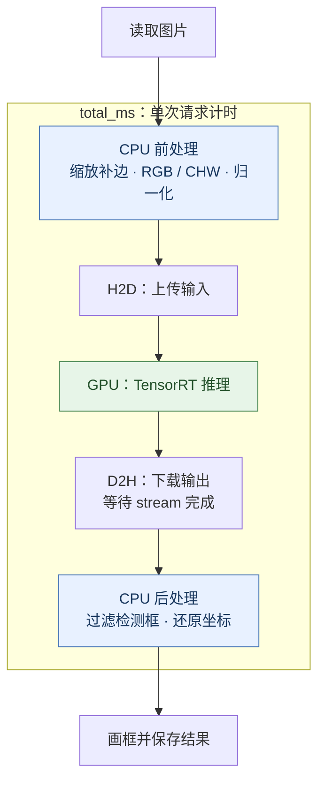

# 01：基础部署与基准测试

## 为什么要"部署"

YOLO 训练得到的 `.pt` 模型，可以在 Python 中通过 PyTorch / Ultralytics 直接加载并完成检测。如果运行环境和性能满足需求，这种方式也可以用于实际应用。当设备对内存占用、推理延迟或程序集成有更高要求时，就需要进一步适配和优化，让模型在目标环境中稳定、高效地运行。

部署就是把模型接入实际应用并满足这些要求。本篇 01 先跑通并测量完整流程，后续各篇以它为基准优化。

## 模型转换

本项目先将 `.pt` 模型导出为 ONNX，保存网络结构和权重；再由 TensorRT 针对目标 GPU 构建 `.engine`，供 C++ 程序加载推理。这个过程不需要重新训练。

```text
训练好的模型（.pt）→ 导出计算图（.onnx）→ TensorRT 编译（.engine）
```

Ultralytics 也提供 `model.export(format="engine")` 接口，可以一次调用完成导出，内部仍会先生成 ONNX，再构建 engine。本项目采用下面的分步方式，便于检查 ONNX、控制构建参数，并生成供当前 C++ 程序直接加载的 engine。

本系列使用 YOLO26m，在仓库根目录执行：

```bash
uv venv .venv-export --python 3.10
uv pip install --python .venv-export/bin/python -r tools/export-requirements.txt

# 1. PT → ONNX：固定输入 640 × 640，Batch 1。
.venv-export/bin/python tools/export_onnx.py yolo26m.pt

# 2. ONNX → Engine：允许内部使用 FP16 计算，输入输出仍为 FP32。
sh tools/build_engine.sh weights/yolo26m.onnx
```

依次得到 `weights/yolo26m.onnx` 和 `weights/yolo26m.fp16.engine`。导出脚本从 `weights/` 读取权重，缺少官方 `yolo26m.pt` 时会自动下载；使用自训练的 YOLO26 检测模型时，先将 `best.pt` 放入该目录，再把两条转换命令中的模型名换成 `best`。输出需符合下文的张量约定。

Engine 在目标 GPU 和 TensorRT 环境中构建。脚本默认调用 `/usr/local/TensorRT/bin/trtexec`，其他安装路径可通过 `TRTEXEC` 指定。

## 检测流程

[main.cpp](../../src/01_baseline/main.cpp) 实现最基本的检测流程：前后处理在 CPU，TensorRT 推理在 GPU，一次处理一张图。



## 前处理：准备模型输入

`preprocess()` 完成等比缩放与灰色补边（Letterbox）、BGR 转 RGB、除以 255 归一化，以及 CHW 排列（依次存放完整的 R、G、B 平面）。

例如，1280 × 720 的图片缩为 640 × 360，上下各补 140 像素，得到 640 × 640 输入。缩放比例和补边位置会保存下来，用于还原检测框。

## 推理：上传、执行、下载

程序加载 engine，创建执行上下文并分配显存，后续请求复用这些资源。`valid_engine()` 检查输入为 FP32 `images [1,3,640,640]`，输出为 FP32 `output0 [1,300,6]`；模型内部可使用 FP16 计算。

`infer()` 在同一 CUDA stream（有序任务队列）中依次提交 H2D、`enqueueV3()` 和 D2H，最后调用 `cudaStreamSynchronize()` 等待完成。CPU 此时才能读取输出，因此推理计时包含传输与同步等待。

## 后处理：过滤并还原检测框

输出每行是 `[x1,y1,x2,y2,score,class_id]`。`postprocess()` 过滤异常值和低于 0.25 的分数，再恢复原图坐标：

```text
原图 x = (模型 x - pad_x) / scale
原图 y = (模型 y - pad_y) / scale
```

恢复后将坐标裁剪到原图范围，丢弃无面积的框。这个 YOLO26 end-to-end 模型无需额外 NMS；画框在计时结束后进行。

## 基准与计时

| CSV 字段 | 计时范围 |
| --- | --- |
| `preprocess_ms` | CPU 缩放、补边、通道转换与归一化 |
| `infer_ms` | H2D、TensorRT、D2H 与同步等待 |
| `postprocess_ms` | CPU 过滤与坐标还原 |
| `total_ms` | 前处理开始至后处理完成 |

各篇统一比较 `total_ms`，不计 engine 加载、资源初始化、解码、预热、画框和文件写入。P50 是请求延迟的中位数。

| 版本 | 请求 P50（ms） | 相对 01 加速比 |
| --- | ---: | ---: |
| 01 基准 | 4.547317 | 1.00× |

其他篇的加速比为 **4.547317 ms ÷ 本篇 P50**，大于 1 表示延迟降低。测试使用 RTX 3060、YOLO26m FP16，每版 6000 个样本；完整条件见[统一报告与原始数据](../benchmarks/rtx3060-yolo26m-2026-10-15/README.md)。

## 运行

按[项目首页](../../README.zh-CN.md#快速开始)准备依赖与 engine，在仓库根目录执行：

```bash
cmake --preset release -DCMAKE_CUDA_ARCHITECTURES=native
cmake --build --preset release --target yolo_baseline -j4
./build/release/src/yolo_baseline weights/yolo26m.fp16.engine images 1000 200
```

末尾两个参数分别是每图测量次数和预热次数，默认 `1 0`。结果写入 `results/01_baseline/`，包含 `timings.csv`、`detections.csv` 和标框图片；重跑覆盖同名结果。

返回：[笔记目录](README.md)。
